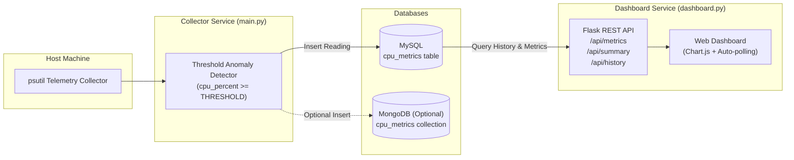

# ⚡ CPU Anomaly Detection & Telemetry System

A real-time system telemetry and anomaly detection platform built with Python, Flask, MySQL, and MongoDB. The system continuously samples CPU utilization, detects spikes beyond configurable thresholds, persists telemetry across relational and document databases, and displays live metrics through a responsive web dashboard.

---

## 📑 Table of Contents

- [Overview](#-overview)
- [Key Features](#-key-features)
- [System Architecture](#-system-architecture)
- [Project Structure](#-project-structure)
- [Prerequisites](#-prerequisites)
- [Installation & Setup](#-installation--setup)
- [Configuration (.env)](#-configuration-env)
- [Running the Application](#-running-the-application)
- [REST API Endpoints](#-rest-api-endpoints)
- [Database Schema](#-database-schema)
- [Troubleshooting & FAQ](#-troubleshooting--faq)
- [License](#-license)

---

## 🔍 Overview

The **CPU Anomaly Detection System** monitors hardware CPU utilization at regular intervals. When CPU consumption exceeds a user-defined threshold, the reading is flagged as an anomaly. 

All telemetry is recorded with timestamps, hostname, and anomaly status into **MySQL** (primary relational store) and optionally **MongoDB** (document store). A lightweight **Flask** web application serves a real-time dashboard featuring KPI cards, an interactive **Chart.js** historical timeline, and a live telemetry log table.

---

## ✨ Key Features

- **Real-Time Telemetry:** Continuous CPU monitoring powered by [`psutil`](https://github.com/giampaolo/psutil) with configurable polling intervals.
- **Automated Anomaly Flagging:** Instant detection and tagging of threshold breaches (e.g., CPU &ge; 60%).
- **Dual-Database Persistence:**
  - **MySQL:** Structured relational storage with auto-created tables and automatic reconnect handling.
  - **MongoDB:** Flexible document storage for multi-cloud or hybrid telemetry pipelines (toggleable via `.env`).
- **Live Interactive Dashboard:**
  - Current CPU usage gauge and progress bar.
  - KPI summary counters (Total Readings, Normal Readings, Total Anomalies).
  - Responsive **Chart.js** line graph highlighting anomalous peaks in red.
  - Recent telemetry records table with color-coded status badges.
  - Automatic background polling every 5 seconds with zero browser cache latency.
- **Resilient Logging:** Dual logging to console stdout and persistent rotating log file (`cpu_monitor.log`).

---

## 🏛️ System Architecture



---

## 📂 Project Structure

```text
CPU Anomaly Detection/
├── .env                  # Active environment variables (git-ignored)
├── .env.example          # Template environment variable configuration
├── .gitignore            # Git ignore definitions
├── cpu_monitor.log       # Application log output
├── dashboard.py          # Flask application serving web dashboard & JSON APIs
├── main.py               # Background daemon collecting CPU readings & anomalies
├── mongo.py              # MongoDB connection & document insertion module
├── requirements.txt      # Python dependencies
├── sql.py                # MySQL connection, table initialization & queries
├── static/
│   └── style.css         # Modern, responsive dashboard styling
├── templates/
│   └── index.html        # Dashboard HTML template with Chart.js integration
└── README.md             # Project documentation
```

---

## 📋 Prerequisites

Ensure you have the following installed on your machine:

1. **Python 3.9+** (Python 3.10, 3.11, or 3.12 recommended)
2. **MySQL Server** (Running locally or remotely on port `3306`)
3. **MongoDB** *(Optional)*: Community Server running locally on port `27017` (if `ENABLE_MONGODB=true`)

---

## 🚀 Installation & Setup

### 1. Clone the Repository

```bash
git clone https://github.com/Atharv3808/CPU-Anomaly-Detection.git
cd "CPU Anomaly Detection"
```

### 2. Create and Activate a Virtual Environment

```bash
# macOS / Linux
python3 -m venv venv
source venv/bin/activate

# Windows
python -m venv venv
venv\Scripts\activate
```

### 3. Install Dependencies

```bash
pip install -r requirements.txt
```

---

## ⚙️ Configuration (.env)

Create a `.env` file in the root directory by copying `.env.example`:

```bash
cp .env.example .env
```

Configure your environment settings in `.env`:

```ini
# ==========================================
# MySQL Configuration
# ==========================================
MYSQL_HOST=127.0.0.1
MYSQL_PORT=3306
MYSQL_USER=cpu_monitor_user
MYSQL_PASSWORD=YourSecurePassword
MYSQL_DATABASE=cpu_monitor

# ==========================================
# MongoDB Configuration (Optional)
# ==========================================
MONGO_URI=mongodb://localhost:27017
MONGO_DATABASE=cpu_monitor
MONGO_COLLECTION=cpu_metrics

# ==========================================
# Telemetry & Anomaly Settings
# ==========================================
CPU_INTERVAL=5          # Sampling interval in seconds
CPU_THRESHOLD=60        # Percentage threshold to trigger anomaly (e.g. 60.0)
ENABLE_MONGODB=true     # Set to 'true' to enable MongoDB, 'false' for MySQL-only

# ==========================================
# Dashboard Server
# ==========================================
FLASK_PORT=5000         # Web dashboard listening port
```

> **Note:** The MySQL database (`cpu_monitor`) should exist before starting. The table `cpu_metrics` will be created automatically upon connection.

---

## 💻 Running the Application

To monitor system telemetry and visualize it in real-time, run the **Monitoring Service** and the **Web Dashboard** in separate terminal sessions.

### Step 1: Start the CPU Monitor Daemon

In your first terminal:

```bash
python main.py
```

**Expected Output:**
```text
2026-10-21 16:00:00 | INFO | Connected to MySQL successfully
2026-10-21 16:00:00 | INFO | Connected to MongoDB successfully
2026-10-21 16:00:00 | INFO | CPU monitoring started (Threshold: 60.0%, Interval: 5s). Press Ctrl+C to stop.
2026-10-21 16:00:05 | INFO | CPU: 24.30% | Anomaly: False
2026-10-21 16:00:10 | INFO | CPU: 67.80% | Anomaly: True
```

### Step 2: Start the Web Dashboard

In your second terminal:

```bash
python dashboard.py
```

**Expected Output:**
```text
 * Serving Flask app 'dashboard'
 * Debug mode: on
 * Running on http://127.0.0.1:5000
```

### Step 3: Access the Dashboard

Open your web browser and navigate to:
```text
http://127.0.0.1:5000
```

---

## 📡 REST API Endpoints

The Flask backend exposes the following JSON endpoints consumed by the live UI:

| Method | Endpoint | Description | Sample Response |
| :--- | :--- | :--- | :--- |
| `GET` | `/` | Renders the HTML Dashboard UI | `text/html` |
| `GET` | `/api/metrics` | Fetches the most recent CPU telemetry reading | `{"hostname": "MacBook.local", "cpu_percent": 42.50, "is_anomaly": false, "recorded_at": "2026-10-21 16:05:00"}` |
| `GET` | `/api/summary` | Aggregated counts of readings and anomalies | `{"total": 120, "normal": 112, "anomalies": 8}` |
| `GET` | `/api/history` | Array of recent readings (default: latest 30) | `[{"hostname": "...", "cpu_percent": 55.2, "is_anomaly": false, "recorded_at": "..."}]` |

---

## 🗄️ Database Schema

### MySQL: `cpu_metrics`

The relational table is automatically initialized by [sql.py](sql.py) if it does not already exist:

```sql
CREATE TABLE IF NOT EXISTS cpu_metrics (
    id BIGINT AUTO_INCREMENT PRIMARY KEY,
    hostname VARCHAR(255) NOT NULL,
    cpu_percent DECIMAL(5,2) NOT NULL,
    is_anomaly TINYINT(1) DEFAULT 0,
    recorded_at TIMESTAMP DEFAULT CURRENT_TIMESTAMP
);
```

### MongoDB: Document Structure

When `ENABLE_MONGODB=true`, documents are inserted into the collection defined in `.env` (`cpu_metrics`):

```json
{
  "_id": { "$oid": "67162981fa12cb489e21890a" },
  "hostname": "MacBook.local",
  "cpu_percent": 68.45,
  "is_anomaly": true,
  "recorded_at": { "$date": "2026-10-21T10:35:00.000Z" }
}
```

---

## 🛠️ Troubleshooting & FAQ

#### 1. `Could not connect to MySQL: Access denied for user...`
- Verify that your MySQL server is running:
  - macOS: `brew services list` or `brew services start mysql`
  - Linux: `sudo systemctl status mysql`
- Check that the database user, password, host, and port in [.env](.env) match your MySQL configuration.
- Grant appropriate privileges to your user:
  ```sql
  CREATE DATABASE IF NOT EXISTS cpu_monitor;
  CREATE USER IF NOT EXISTS 'cpu_monitor_user'@'localhost' IDENTIFIED BY 'CpuMonitor@123';
  GRANT ALL PRIVILEGES ON cpu_monitor.* TO 'cpu_monitor_user'@'localhost';
  FLUSH PRIVILEGES;
  ```

#### 2. `MongoDB disabled via configuration`
- This is intentional if `ENABLE_MONGODB=false` in `.env`.
- To enable MongoDB, set `ENABLE_MONGODB=true` and verify your local MongoDB daemon is running:
  - macOS: `brew services start mongodb-community`
  - Linux: `sudo systemctl start mongod`

#### 3. Why is `certifi` not required?
- `certifi` is only required when connecting to cloud SSL/TLS clusters (e.g. MongoDB Atlas with `mongodb+srv://`). Local MongoDB instances connect over standard unencrypted local sockets, eliminating the need for SSL certificate validation packages.

#### 4. How do I test an anomaly spike?
- Temporarily lower `CPU_THRESHOLD` in `.env` to `10` or `20`, or generate artificial CPU load in a separate terminal:
  ```bash
  # Generate temporary CPU load on Unix/macOS
  yes > /dev/null &
  # To stop the load:
  killall yes
  ```

---

## 📄 License

This project is open-source and available under the [MIT License](LICENSE).
